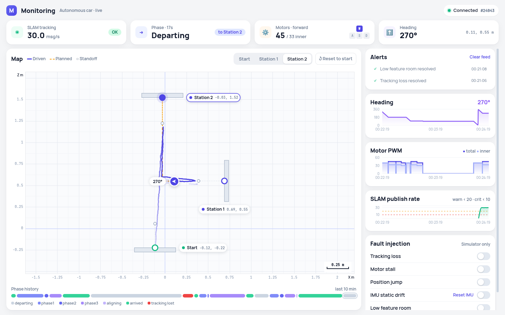
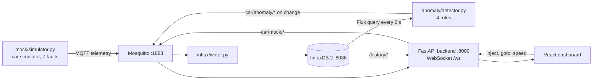

<picture>
  <source media="(prefers-color-scheme: dark)" srcset="docs/media/banner-dark.svg">
  
</picture>

# Robot Telemetry Monitoring

Telemetry storage, rule-based anomaly detection and a live dashboard for a mobile robot, built with MQTT (Mosquitto), InfluxDB 2, FastAPI and React, and tested against a car simulator with 7 injectable faults.

> **Status: simulated data only.** I built this for my [monocular SLAM RC car](https://github.com/LakhdariAnis/monocular-slam-navigation), but it was never connected to the real car: the ZMQ to MQTT bridge was not written, and the car is no longer available. Everything below runs on `mock/simulator.py`.



## Overview

The simulator plays the car's navigator: it drives the same L-path between three stations and publishes pose (30 Hz), IMU (50 Hz), motor and phase messages over MQTT. A writer stores every message in InfluxDB. A detector queries InfluxDB every 2 s with Flux, runs four rules over sliding windows, and publishes an anomaly only when a rule changes state. The dashboard shows live data over a WebSocket, history charts, and buttons to inject faults.

## Architecture



## Anomaly rules

| Anomaly | Window | Fires when | Severity |
|---|---|---|---|
| `tracking_loss` | 5 s | more than 60% of poses have `ok = false` | CRIT |
| `motor_stall` | 6 s | forward command in at least 70% of motor samples **and** pose spread under 4 mm | CRIT |
| `imu_static_drift` | 30 s | car stopped **and** heading slope of the second half above 0.00005°/sample and growing | CRIT |
| `slam_low_feature` | 5 s | pose rate below 22 Hz, skipped while the window is still filling or while `tracking_loss` is active | WARN |

## Results

`mock/stress_test.py` runs 18 scenarios against the simulator at 4× speed, with the writer and the detector running. Last run on 2026-11-06 (report in [`mock/stress_test_report.txt`](mock/stress_test_report.txt)): **14 of 18 passed.**

| Test | Duration | Evidence | Result |
|---|---|---|---|
| Route start → station_1 → station_2 → start | 39.6 s | all 3 legs arrived | pass |
| Route start → station_2 → station_1 → start | 36.6 s | all 3 legs arrived | pass |
| Baseline, no anomalies | 23.6 s | all 6 phases seen | pass |
| `tracking_loss` | 16.9 s | 517 lost poses, 2 `tracking_lost` phase events | pass |
| `motor_stall` severity 1.0 | 18.9 s | 1 stall alert, position frozen | pass |
| `motor_stall` severity 0.5 (arc) | 18.9 s | no stall alert | fail, by design (see below) |
| `position_jump` | 75.0 s | fired, reset, fired again | pass |
| `phase_timeout` | 24.2 s | navigation still progressing | pass |
| `imu_static_drift` | 42.4 s | 0.32° accumulated over 40 s | pass |
| `trajectory_drift` | 18.8 s | max lateral deviation 0.0115 m | pass |
| `slam_low_feature` | 12.2 s | message gap 12.9 ms → 17.0 ms, then recovery | pass |
| tracking_loss + motor_stall | 27.0 s | no stall alert | fail, detector limit |
| imu_drift suppressed by motor_stall | 16.6 s | max drift 0.108° | pass |
| trajectory_drift + motor_stall | 27.1 s | no stall alert | fail, detector limit |
| All 7 anomalies at once | 27.8 s | 5151 messages, simulator alive | pass |
| 10 rapid on/off toggles | 12.7 s | stable, 922 messages | pass |
| `position_jump` reset × 3 | 113.3 s | fired in cycles 2 and 3, not in cycle 1 (`[0, 2, 2]`) | fail, flaky timing |
| sim_speed 0.25× / 4× | 12.7 s | 38 / 571 SLAM messages in 5 s | pass |

**Why the 4 failures happen:**
- **Arc stall (severity 0.5):** the car still moves, so the position-spread rule can't fire. An arc-stall warning was left out on purpose: with one gyro heading, arc-turning can't be told apart from IMU drift.
- **Stall during tracking loss:** lost poses have no `x`/`z`, so the stall rule has no position to check. A stall can't be seen from SLAM while SLAM is lost.
- **Stall during trajectory drift:** the injected lateral bend moves the pose by more than 4 mm, so the rule sees movement.
- **Position jump, cycle 1:** the jump only fires during a spin, and in the first cycle the inject landed outside one. Cycles 2 and 3 fired.

The first three are limits of a stall rule that uses SLAM position only. A motor-current or wheel-speed signal would fix them on real hardware.

## What I built vs reused

- **Built (solo):** the simulator and its fault injection, the MQTT to InfluxDB writer, the detector and its rules, the FastAPI backend, the React dashboard, the Docker Compose setup, the launcher and the stress test.
- **Reused:** Eclipse Mosquitto, InfluxDB 2, paho-mqtt, influxdb-client, FastAPI, Uvicorn, React 18 and Recharts (from CDN).

## Components

| Path | What it does |
|---|---|
| `docker-compose.yml` | Mosquitto (`eclipse-mosquitto:2`) and InfluxDB (`influxdb:2`, setup mode: org `car_org`, bucket `car_telemetry`, user `admin`). Credentials come from `.env`. |
| `mosquitto/config/mosquitto.conf` | `listener 1883`, `allow_anonymous true`, persistence in `mosquitto/data/`, logs to `mosquitto/log/` and stdout. |
| `launch.py` | Runs `docker-compose up -d`, loads `.env`, then opens one terminal window per script: simulator, writer, detector, backend. |
| `mock/simulator.py` | Car simulator with 7 injectable anomalies and runtime controls over `car/mock/*`. |
| `mock/inject.py` | CLI: `python3 mock/inject.py <anomaly> on\|off` or `python3 mock/inject.py list`. |
| `mock/stress_test.py` | 18 scenario tests against a running simulator at 4× speed; writes `stress_test_report.txt`. |
| `influx/writer.py` | MQTT to InfluxDB writer for the 4 telemetry topics. |
| `anomaly/detector.py` | Rule-based anomaly detector (Flux queries on InfluxDB). |
| `anomaly/peek.py` | Prints recent rows: `python3 anomaly/peek.py car/motors w a s d [window_seconds]`. |
| `anomaly/drift_test.py` | Resets the simulator, injects `imu_static_drift`, prints heading and alert state every second. |
| `dashboard/backend/main.py` | FastAPI app on port 8000: WebSocket, history, mock-control endpoints, static frontend. |
| `dashboard/frontend/` | `index.html` + `App.js` (compiled from `App.jsx` with Babel). |


## How to run

### 1. Requirements

- Docker with Compose
- Python 3 with: `pip install paho-mqtt influxdb-client fastapi 'uvicorn[standard]'`
  (there is no requirements file; tested with Python 3.14, paho-mqtt 2.1.0, influxdb-client 1.50.0, fastapi 0.159.1, uvicorn 0.54.0). Plain `uvicorn` without `[standard]` has no WebSocket support: `/ws` returns 404 and the dashboard gets no live data.
- `mosquitto_pub` / `mosquitto_sub` (optional, for manual testing)

### 2. Credentials

```bash
cp .env.example .env      # then set INFLUXDB_ADMIN_PASSWORD and INFLUXDB_TOKEN
```

`.env` is gitignored. `docker compose` reads it automatically and refuses to start if either value is missing. `launch.py` passes it to the Python scripts. When you run a script by hand, export it first:

```bash
set -a; source .env; set +a
```

InfluxDB applies the password and token **only on first start**, when `influxdb/data/` is empty. If you change them later, the existing database keeps the old token. To start over with new values, stop the stack and delete `influxdb/data/` (this deletes all stored telemetry).

### 3. Start everything

```bash
python3 launch.py
```

Open **http://localhost:8000**.

### Manual start (one terminal each)

```bash
docker compose up -d
set -a; source .env; set +a
python3 mock/simulator.py
python3 influx/writer.py
python3 anomaly/detector.py
cd dashboard/backend && python3 main.py      # BACKEND_PORT env var overrides 8000
```

### Mock mode controls

Drive the simulator from the dashboard (station buttons, Reset to Start, simulation speed slider, anomaly toggles), from the CLI, or with raw MQTT:

```bash
python3 mock/inject.py motor_stall on
mosquitto_pub -h localhost -t car/mock/goto   -m '{"target":"station_1"}'
mosquitto_pub -h localhost -t car/mock/inject -m '{"anomaly":"tracking_loss","active":true}'
```

### Rebuild the frontend

`package.json` has no build script, and `node_modules/.bin` is missing, so call Babel directly:

```bash
cd dashboard/frontend
npm install
node node_modules/@babel/cli/bin/babel.js App.jsx -o App.js
```

The dashboard loads React 18, Recharts 2.12.7, Tailwind and Google Fonts from CDNs, so the browser needs internet access.

---

## Ports

| Port | Service | Notes |
|---|---|---|
| 1883 | Mosquitto MQTT | anonymous access |
| 9001 | Mosquitto | mapped in compose, but `mosquitto.conf` has no listener on it |
| 8086 | InfluxDB 2 HTTP API / UI | |
| 8000 | Dashboard backend + frontend | `BACKEND_PORT` env var |

---

## MQTT topics

### Telemetry (published by the simulator)

| Topic | Rate | Payload |
|---|---|---|
| `car/slam/pose` | 30 Hz | `{seq, ts, ok, x, z}` — `x`/`z` are `null` when `ok` is false |
| `car/imu` | 50 Hz | `{ts, heading_deg, true_heading_deg, raw_ax, raw_ay, moving, drift_elapsed_s, accumulated_drift_deg}` |
| `car/motors` | on change | `{w, a, s, d, total, inner, ts}` — same command shape the navigator sends to `car.py` |
| `car/nav/phase` | on change | `{phase, target_station, ts}` — phases: `departing`, `phase1`, `phase2`, `phase3`, `aligning`, `arrived`, `tracking_lost` |

`true_heading_deg`, `drift_elapsed_s` and `accumulated_drift_deg` are simulator-only fields, used to show injected IMU drift.

### Anomalies

| Topic | Published by | Payload |
|---|---|---|
| `car/anomaly/tracking_loss` | detector | `{type, severity: "CRIT", false_count, total_count, false_ratio, ts}` |
| `car/anomaly/motor_stall` | detector | `{type, severity: "CRIT", w_true_ratio, position_spread_mm, ts}` |
| `car/anomaly/imu_static_drift` | detector | `{type, severity: "CRIT", rate_first_half, rate_second_half, acceleration, heading_start, heading_end, ts}` |
| `car/anomaly/slam_low_feature` | detector | `{type, severity: "WARN", msg_count, rate_hz, ts}` |
| `car/anomaly/position_jump` | simulator | `{type, severity: "CRIT", jump_x, jump_z, magnitude, ts}` |

When a detector rule stops firing, it publishes `{type, severity: "CLEARED", ts}` on the same topic.

### Mock control (subscribed by the simulator)

| Topic | Payload |
|---|---|
| `car/mock/goto` | `{"target": "start" \| "station_1" \| "station_2"}` |
| `car/mock/reset` | `{"station": "start"}` — teleport and dock |
| `car/mock/inject` | `{"anomaly": "<name>", "active": true\|false}` |
| `car/mock/sim_speed` | `{"speed": 0.25 … 4.0}` (clamped) |
| `car/mock/motor_stall_params` | `{"severity": 0.0 … 1.0}` — 1.0 freezes position, below 1.0 the car arcs sideways |
| `car/mock/slam_params` | `{"decay": float, "recover": float}` — per-tick SLAM rate factors for `slam_low_feature` |
| `car/mock/position_jump_params` | `{"probability": 0.0 … 1.0}` |
| `car/mock/imu_drift_reset` | `{}` |

The simulator also publishes `car/mock/motor_stall_arc` `{arc_side: -1 | 1 | null}` for the dashboard.

---

## InfluxDB schema

- **Telemetry:** one measurement per topic (`car/slam/pose`, `car/imu`, `car/motors`, `car/nav/phase`). The timestamp comes from the payload `ts`. The writer stores only these fields:
  - pose: `seq`, `ok`, `x`, `z` (`x`/`z` are skipped when `null`)
  - IMU: `heading_deg`, `raw_ax`, `raw_ay`, `moving`
  - motors: `w`, `a`, `s`, `d`, `total`, `inner`
  - phase: `phase`, `target_station`
- **Anomalies:** measurement `car/anomaly`, tags `type` and `severity`, every other payload key as a field. The detector writes these directly; the writer does not subscribe to `car/anomaly/*`.

---

## Anomaly detection

`anomaly/detector.py` runs four checks every `CHECK_INTERVAL_S = 2` seconds, each over a sliding window queried from InfluxDB:

| Anomaly | Window | Fires when | Severity |
|---|---|---|---|
| `tracking_loss` | 5 s | more than 60% of `car/slam/pose` rows have `ok = false` | CRIT |
| `motor_stall` | 6 s | `w` (forward) is true in at least 70% of motor samples, **and** the pose spread (x range + z range) is under 4 mm | CRIT |
| `imu_static_drift` | 30 s | no motor command active and `moving` never true in the window, **and** the heading slope of the second half is above 0.00005°/sample **and** larger than the first half × 1.01 | CRIT |
| `slam_low_feature` | 5 s | pose message rate below 22 Hz | WARN |

Details:

- **Sparse motor topic:** `car/motors` is published only on change, so the motor checks carry the last command from before the window forward (looking back up to 30 min).
- **Heading unwrap:** headings are unwrapped across 0/360 before a least-squares slope is fitted to each half of the window. Drift is flagged only if it is significant *and* growing.
- **No arc-stall warning:** a WARN level for motor stall (a car arcing instead of driving straight) is left out on purpose. With one gyro heading source, arc-turning can't be told apart from IMU drift while the motors run.
- **Placeholder thresholds:** the `imu_static_drift` thresholds are marked TODO in the code. They need tuning with `peek.py` data from the real car.

Anomalies the simulator can inject but the detector does not detect: `position_jump` (the simulator reports it itself), `phase_timeout`, `trajectory_drift`.


---

## Dashboard

The backend (`dashboard/backend/main.py`) exposes:

| Method | Path | Purpose |
|---|---|---|
| WS | `/ws` | JSON snapshot of the latest message per topic on every MQTT message; anomaly messages are also sent as `{"_anomaly": true, "entry": …}` |
| GET | `/history/slam`, `/history/imu`, `/history/motors`, `/history/phase` | InfluxDB rows, `?minutes=1…1440` (default 10) |
| GET | `/anomalies` · POST `/anomalies/clear` | Latest entry per anomaly type |
| GET | `/live/slam_rate` | Pose msgs/s over the last 2 s: `ok` ≥ 20, `warn` ≥ 10, else `critical` |
| GET | `/live/motor_stall`, `/live/sim_speed`, `/live/position_jump`, `/live` | Current mock state |
| POST | `/api/inject`, `/api/goto`, `/api/publish`, `/sim/reset` | Publish to the `car/mock/*` topics (`/api/publish` accepts any topic) |
| POST | `/control/sim_speed`, `/control/position_jump_params`, `/control/imu_drift_reset` | Mock controls |
| GET | `/` | Static frontend |

The frontend shows:

- a status bar (SLAM tracking, phase, motor state, WebSocket)
- a navigation map with stations, live position and path, and goto / reset buttons
- a phase timeline, IMU heading chart, motor PWM chart (total / inner) and SLAM publish rate
- an anomaly feed
- a side panel with the simulation speed slider and anomaly toggles (Tracking Loss, Motor Stall, Position Jump, IMU Static Drift, Low Feature Room)

The frontend expects the backend at `http://localhost:8000` (`API_BASE` in `App.jsx`).

---

## Limitations and future work

- **No real data.** There is no ZMQ to MQTT bridge, so the stack only sees simulator data. A next step is to feed it from a ROS 2 simulation of the car.
- **Detector coverage:** 4 of the 6 failure modes have a rule. `phase_timeout` and `trajectory_drift` have none, and `position_jump` is reported by the simulator itself.
- **Placeholder thresholds:** the `imu_static_drift` thresholds were never tuned on real hardware, and the rule reacts slowly (about 90 s real time in a test at 4× speed).
- **Simulator arc mode:** in motor-stall mode with severity below 1.0, the car keeps moving but `car/imu` reports `moving: false`.
- **OPC-UA:** an OPC-UA server for industrial clients is planned, not implemented.
- The dashboard loads React, Recharts, Tailwind and Google Fonts from CDNs, so the browser needs internet access.

## Context

Part of my 2CS end-of-year project at École Supérieure en Informatique, Sidi Bel Abbès (Algeria), 2025/2026. This code was first developed in the `monitoring/` folder of [monocular-slam-navigation](https://github.com/LakhdariAnis/monocular-slam-navigation) and moved here with its history.

Author: Anis Charaf Eddine Lakhdari.

## License

MIT. See [`LICENSE`](LICENSE).
